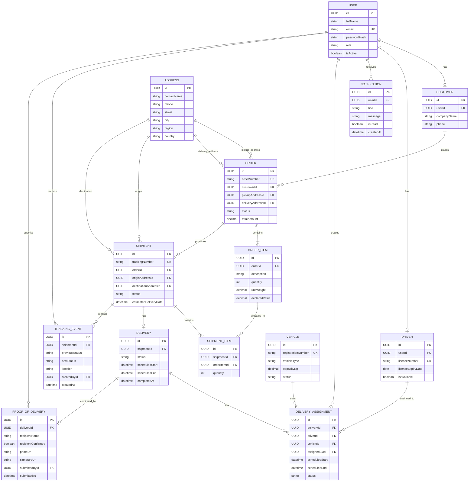

# Nexora Logistics - Entity Relationship Diagram

## 1. Overview

This diagram represents the main database entities and their relationships.

The system uses PostgreSQL with Prisma ORM.

## 2. Entity Relationship Diagram

## 3. Relationship Explanation

- A user may have a customer profile or driver profile.
- A customer can place multiple orders.
- Each order contains one or more order items.
- One order may produce multiple shipments.
- Shipment items connect order items to shipments.
- Each shipment can have one delivery record.
- Each delivery can have multiple assignment records over time.
- A driver and vehicle can participate in multiple assignments over time.
- A completed delivery can have one proof of delivery record.
- A shipment can have many tracking events.
- A user can receive multiple notifications.

## 4. Important Design Decisions

1. UUIDs are used as primary keys.
2. Orders and shipments are separate entities because an order may be split into multiple shipments.
3. ShipmentItem supports partial shipment of order items.
4. DeliveryAssignment preserves driver and vehicle assignment history.
5. TrackingEvent preserves shipment status history.
6. ProofOfDelivery is stored separately to maintain delivery evidence.
7. Public tracking uses a unique tracking number rather than exposing internal database IDs.
