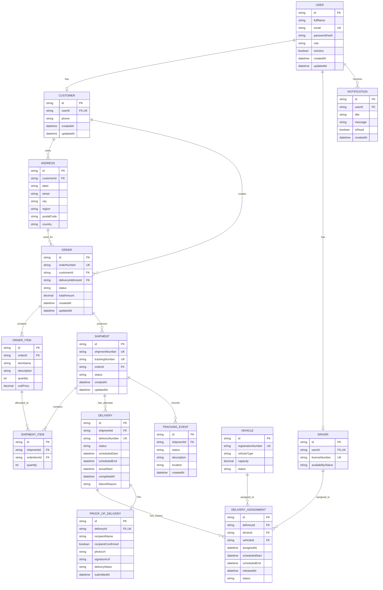

# Nexora Logistics – Entity Relationship Diagram (ERD)

## 1. Overview

This ER diagram represents the main database entities and their relationships in the Nexora Logistics system.

The database uses PostgreSQL, with Prisma ORM managing database operations.

## 2. Entity Relationship Diagram

## 3. Relationship Explanations

| Relationship                  | Explanation                                             |
| ----------------------------- | ------------------------------------------------------- |
| User – Customer               | A user may have one customer profile                    |
| User – Driver                 | A user may have one driver profile                      |
| Customer – Address            | A customer can save multiple addresses                  |
| Customer – Order              | A customer can create multiple orders                   |
| Order – OrderItem             | An order contains one or more items                     |
| Order – Shipment              | An order can be split into multiple shipments           |
| Shipment – ShipmentItem       | A shipment contains one or more shipment items          |
| OrderItem – ShipmentItem      | An order item can be allocated across shipments         |
| Shipment – Delivery           | A shipment can have multiple delivery attempts          |
| Delivery – DeliveryAssignment | A delivery can have multiple assignment history records |
| Driver – DeliveryAssignment   | A driver can have multiple assignments over time        |
| Vehicle – DeliveryAssignment  | A vehicle can have multiple assignments over time       |
| Delivery – ProofOfDelivery    | A delivery can have one proof of delivery               |
| Shipment – TrackingEvent      | A shipment can have multiple tracking events            |
| User – Notification           | A user can receive multiple notifications               |

## 4. Important Design Decisions

### Multiple Delivery Attempts

A shipment can have multiple delivery attempts.

For example:

- First attempt: FAILED because the customer was unavailable.
- Second attempt: RESCHEDULED.
- Third attempt: DELIVERED successfully.

All attempts remain stored in the database.

### Assignment History

A delivery can have multiple assignment records.

This allows the system to preserve previous driver and vehicle assignments when a delivery is reassigned.

### Proof of Delivery

Each successful delivery attempt can have one ProofOfDelivery record.

A failed attempt does not require a ProofOfDelivery record.

### Shipment Tracking

TrackingEvent stores shipment status history.

Each status update should create a new tracking event rather than overwriting previous events.

### Order Completion

An order is completed only when all its associated shipments have been successfully delivered.

## 5. Database Integrity

The following constraints must be implemented:

- Primary keys for all entities.
- Foreign keys for relationships.
- Unique user email addresses.
- Unique tracking numbers.
- Unique order and shipment numbers.
- Unique driver license numbers.
- Unique vehicle registration numbers.
- Unique delivery numbers.
- Unique ProofOfDelivery delivery IDs.
- Positive quantities.
- Nonnegative prices and vehicle capacity.
- Valid delivery scheduling periods.

Additional business rules will be enforced through backend services and database transactions.

## 6. Implementation Note

This ERD represents the planned logical database design. The actual Prisma schema may introduce additional fields, indexes, enums, and constraints during implementation.
