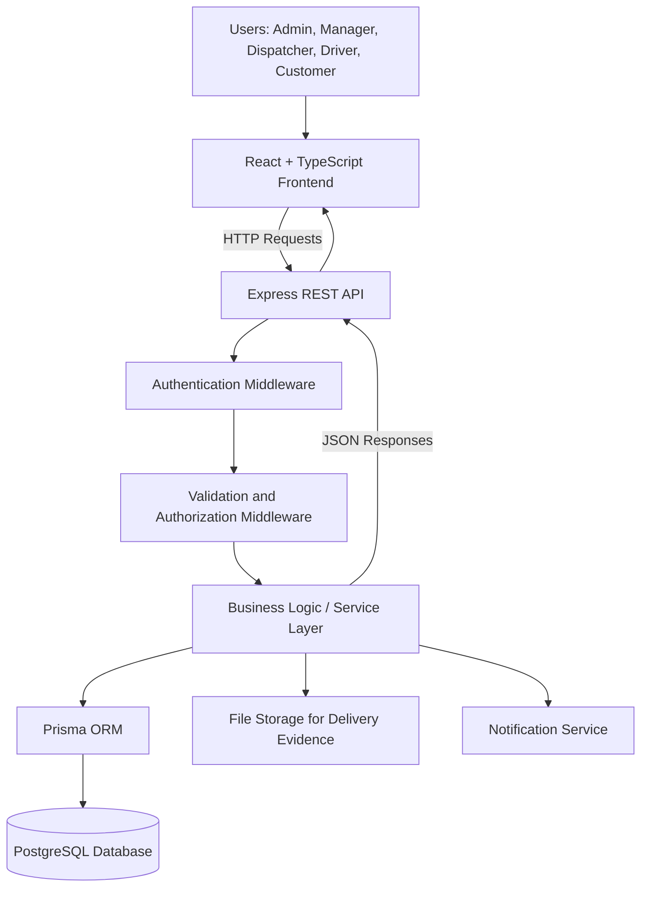

# Nexora Logistics – System Architecture

## 1. Overview

Nexora Logistics follows a three-tier architecture consisting of:

1. **Presentation Layer:** React and TypeScript frontend.
2. **Application Layer:** Node.js and Express backend.
3. **Data Layer:** PostgreSQL database managed through Prisma ORM.

The architecture separates the user interface, business logic, and data storage to improve maintainability, security, scalability, and testability.

## 2. Technology Stack

| Layer             | Technology     | Responsibility          |
| ----------------- | -------------- | ----------------------- |
| Frontend          | React          | User interface          |
| Frontend Language | TypeScript     | Type safety             |
| Styling           | Tailwind CSS   | Responsive design       |
| Backend           | Node.js        | Server runtime          |
| Backend Framework | Express.js     | REST API                |
| Backend Language  | TypeScript     | Type safety             |
| ORM               | Prisma         | Database access         |
| Database          | PostgreSQL     | Persistent data storage |
| Authentication    | JWT            | User authentication     |
| API Testing       | Postman        | API verification        |
| Unit Testing      | Vitest         | Automated testing       |
| Version Control   | Git and GitHub | Source code management  |

## 3. High-Level Architecture

## 4. Frontend Architecture

The frontend is responsible for displaying information and allowing users to interact with the system.

### Main Modules

- Authentication and user management
- Dashboard
- Customer management
- Order management
- Shipment management
- Delivery management
- Driver management
- Vehicle management
- Customer tracking
- Proof of Delivery
- Notifications
- Reports

### Frontend Responsibilities

- Display information based on the authenticated user's role.
- Validate user input before submitting requests.
- Communicate with backend REST API endpoints.
- Display success messages and errors.
- Provide responsive layouts for desktop, tablet, and mobile devices.

The frontend must never connect directly to the PostgreSQL database.

## 5. Backend Architecture

The backend handles business logic, authentication, authorization, validation, and database operations.

### Main Backend Layers

**1. Routes**

Define API endpoints and connect incoming requests to controllers.

**2. Middleware**

Handles authentication, role-based access control, request validation, and error handling.

**3. Controllers**

Receive HTTP requests, call the appropriate services, and return HTTP responses.

**4. Services**

Contain the main business logic, including:

- Order processing
- Shipment status management
- Delivery scheduling
- Driver and vehicle assignment
- Proof of Delivery verification
- Customer tracking
- Notification handling

**5. Prisma Data Access**

Communicates with PostgreSQL using Prisma ORM.

## 6. Database Architecture

PostgreSQL stores the application's persistent information.

The database contains the following main entities:

- User
- Customer
- Address
- Order
- OrderItem
- Shipment
- ShipmentItem
- Driver
- Vehicle
- Delivery
- DeliveryAssignment
- ProofOfDelivery
- TrackingEvent
- Notification

Prisma ORM manages database access, relationships, migrations, and queries.

## 7. Authentication and Authorization

The system uses JSON Web Tokens (JWT) for authentication.

### Authentication Flow

1. A user submits login credentials.
2. The backend validates the credentials.
3. The backend generates an authentication token.
4. The frontend stores the token using an appropriate secure strategy.
5. The frontend includes the token in protected API requests.
6. The backend verifies the token before allowing access.

### Role-Based Access Control

The system supports the following roles:

| Role                 | Main Permissions                                      |
| -------------------- | ----------------------------------------------------- |
| System Administrator | Manage users and system settings                      |
| Logistics Manager    | Manage logistics operations and reports               |
| Dispatcher           | Manage orders, shipments, deliveries, and assignments |
| Driver               | View assigned deliveries and submit delivery updates  |
| Customer             | Create orders and track personal shipments            |

Authorization must always be enforced by the backend, not only by hiding frontend components.

## 8. Main Request Lifecycle

When a user performs an operation, the following process takes place:

1. The user interacts with the React frontend.
2. The frontend sends an HTTP request to the Express API.
3. Authentication middleware verifies the user's identity.
4. Authorization middleware checks the user's permissions.
5. Validation middleware checks the request data.
6. The controller calls the appropriate service.
7. The service executes the business rules.
8. Prisma communicates with PostgreSQL when database operations are required.
9. The backend returns a JSON response.
10. The frontend updates the user interface.

## 9. Proof of Delivery File Handling

Proof of Delivery may include recipient information, delivery notes, photographs, and signatures.

The backend will validate uploaded evidence and associate it with the relevant delivery record.

During development, local file storage may be used. A cloud storage solution can be considered for production deployment.

Sensitive delivery evidence must not be publicly accessible through predictable file URLs.

## 10. Customer Tracking Architecture

The system supports two tracking methods:

### Public Tracking

- Customers enter a unique tracking number.
- The frontend requests shipment information from the public tracking endpoint.
- The backend returns only approved customer-facing tracking information.

### Authenticated Tracking

- Customers log into their accounts.
- The backend identifies the authenticated customer.
- Customers can view only their own orders and shipments.

Private operational information must not be exposed through public tracking.

## 11. Security Considerations

The system will implement the following security measures:

- Password hashing.
- JWT-based authentication.
- Role-based authorization.
- Request validation.
- Secure handling of environment variables.
- Protection against unauthorized database access.
- Rate limiting on sensitive endpoints.
- Secure file upload validation.
- Protection of customer information.
- Server-side validation of all business rules.

## 12. Deployment Architecture

The initial development environment will run locally.

The frontend, backend, and PostgreSQL database will be configured as separate components.

Production deployment may use:

- A frontend hosting platform.
- A Node.js-compatible backend hosting platform.
- A managed PostgreSQL database.
- Cloud file storage for delivery evidence.

The final hosting providers will be selected during deployment planning.

## 13. Architecture Scope

The initial MVP will focus on:

- Order management.
- Shipment management.
- Delivery scheduling.
- Driver and vehicle assignment.
- Proof of Delivery.
- Customer tracking.
- User authentication and authorization.
- Notifications.
- Reporting.

Advanced GPS tracking, automatic route optimization, and third-party integrations are outside the initial MVP scope.

## 14. Architecture Principles

The project will follow these principles:

1. Separation of concerns.
2. Reusable and maintainable components.
3. Secure API communication.
4. Backend enforcement of business rules.
5. Database consistency.
6. Responsive user interface.
7. Automated testing.
8. Clear documentation.
